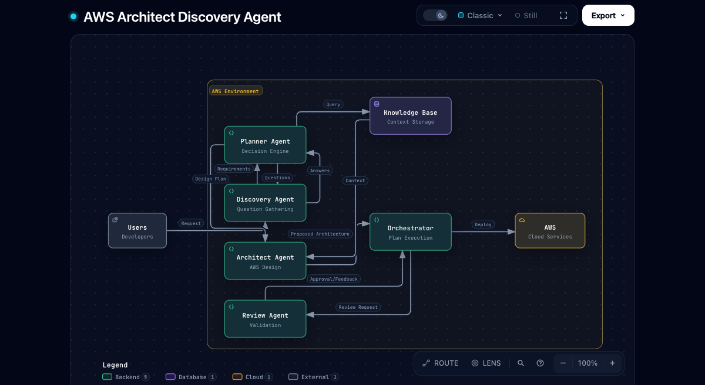
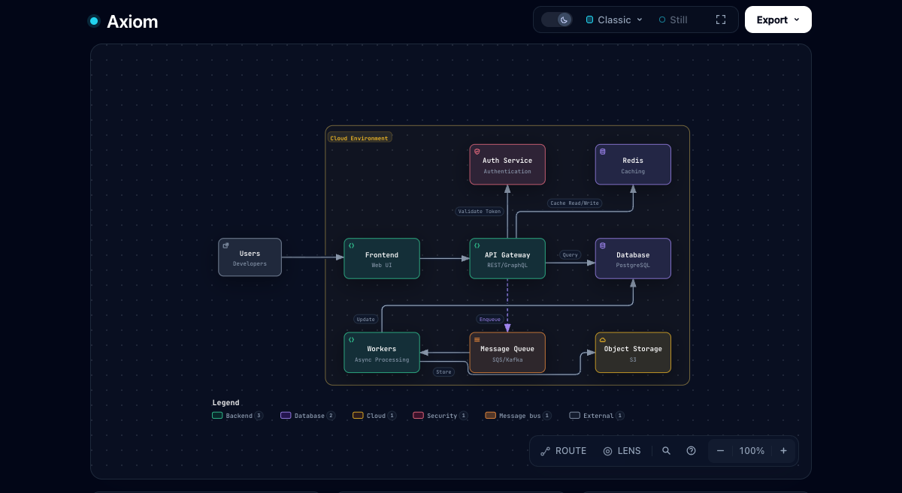
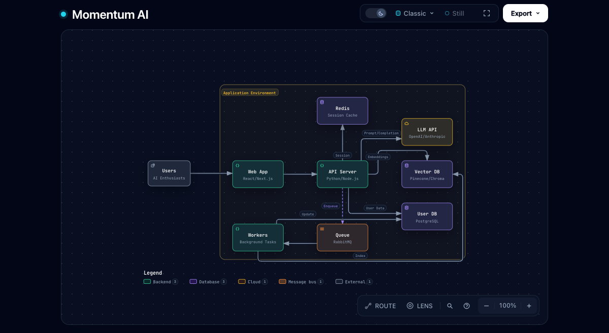
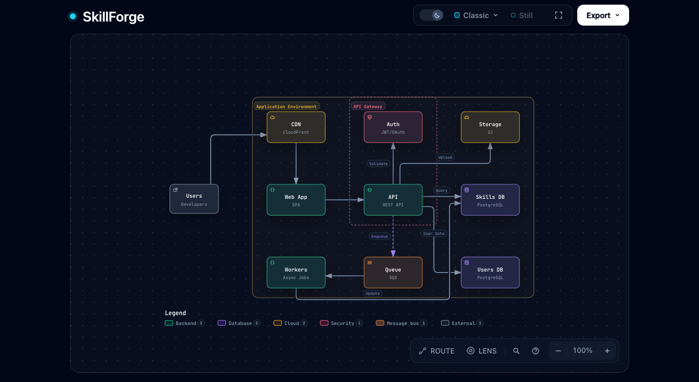

# 👋 Hi, I'm Billy G

## 📫 Contact Me

## 📖 About Me

I'm an AWS Certified Solutions Architect and full-stack developer passionate about building cloud-native AI solutions. I specialize in designing scalable architectures on AWS and creating intelligent applications that leverage modern AI/ML capabilities.

Currently focused on:
- Building autonomous AI agents and agentic workflows
- Designing enterprise-grade AWS architectures
- Creating practical AI/ML applications that solve real-world problems
- Developing developer tools that streamline cloud workflows

## 🚀 Projects

### [AWS-Architect-Discovery-Agent](https://github.com/GibzB/AWS-Architect-Discovery-Agent)

An autonomous AI Solutions Architect that conducts enterprise cloud discovery workshops through natural voice and chat conversations. Uses multi-agent reasoning with Amazon Nova Pro and Lite to produce implementation-ready deliverables including Terraform code and architecture diagrams.

**Tech Stack:** React, TypeScript, FastAPI, Amazon Bedrock, Terraform, DynamoDB, S3

### [Axiom](https://github.com/GibzB/Axiom)

An agentic decision-intelligence platform that captures why technical decisions were made and re-evaluates assumptions when new evidence appears. Uses Amazon Nova 2 Lite for reasoning and CockroachDB's distributed vector index for semantic memory.

**Tech Stack:** React, TypeScript, Vite, FastAPI, Amazon Bedrock, CockroachDB

### [momentum-ai](https://github.com/GibzB/momentum-ai)

AI-powered project prioritization assistant that helps teams decide what to work on next. Analyzes projects, deadlines, and task descriptions to deliver ranked recommendations with explanations using Amazon Bedrock Nova Lite.

**Tech Stack:** React 19, TypeScript, FastAPI, Amazon Bedrock, DynamoDB, Terraform, AWS Amplify

### [skillforge](https://github.com/GibzB/skillforge)

Turn any public documentation page into an Agent Pack that AI coding agents can use. Extracts knowledge, compiles evidence-backed Knowledge Graphs, and packages results as portable ZIP downloads.

**Tech Stack:** Next.js, FastAPI, Python 3.12, Firecrawl, CometAPI

---

## 🏗️ About the Diagrams

Architecture diagrams are generated with [Archify](https://github.com/tt-a1i/archify) and feature:
- 🌓 Dark/Light theme support
- 🔍 Interactive node exploration
- 🛤️ Path tracing and route highlighting
- 📊 Source-backed architecture evidence

Click any diagram above to explore the full interactive version.

